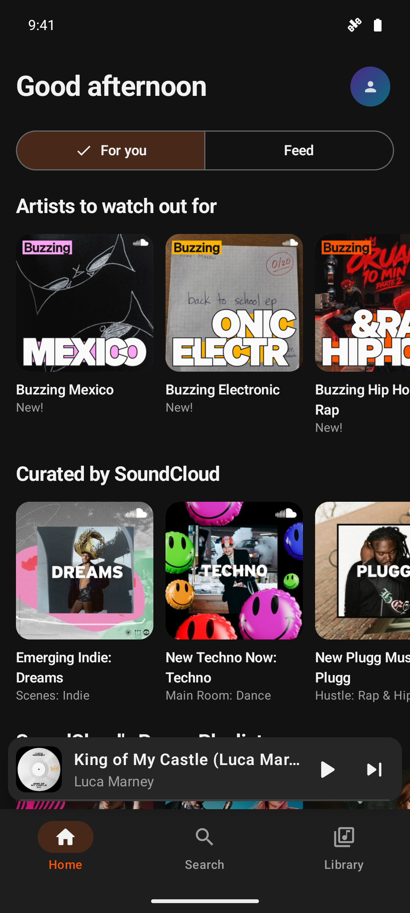
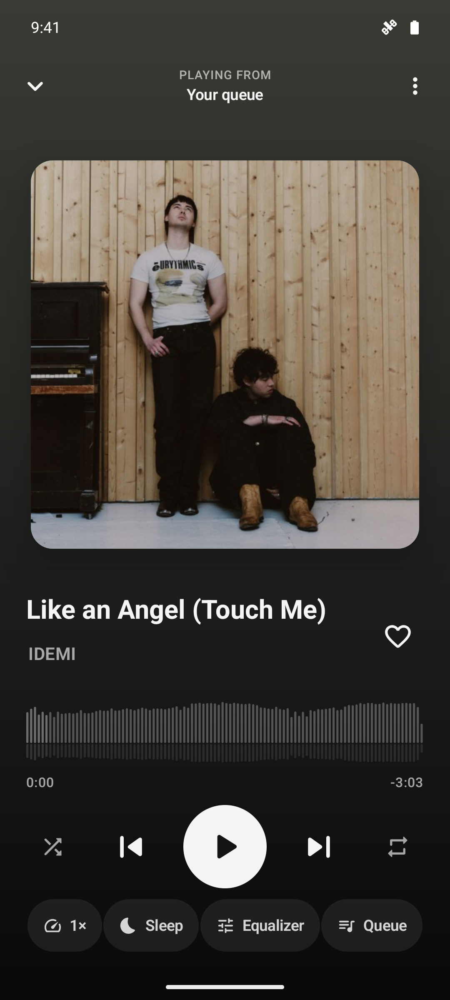
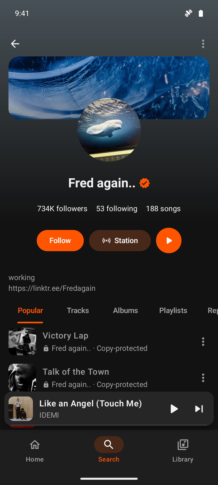
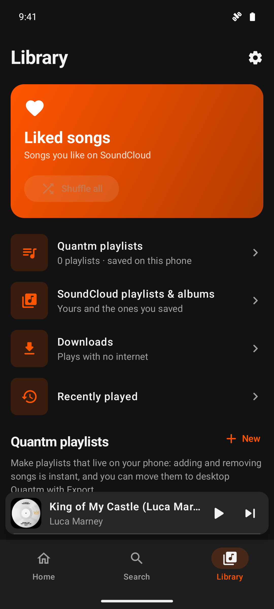
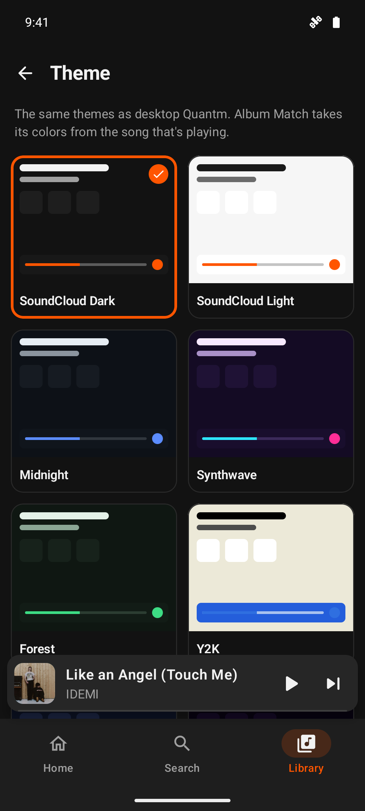

# Quantm for Android

**SoundCloud without the ads**, as a real Android app. The phone version of [Quantm](https://github.com/quantm-app/Quantm): free, open source, no ads, no tracking.

<p>
  
  
  
  
  
</p>

## Download

Get **`Quantm-VERSION.apk`** from the [latest release](https://github.com/quantm-app/Quantm-Android/releases/latest) and open it on your phone. Android asks once to allow installs from your browser or file manager: allow it, then tap **Install**.

Quantm updates itself: when a new version is out, it offers to install it (Settings → Check for updates).

Needs Android 8.0 or newer.

## Features

- **No ads.** No audio ads, banners or promoted posts in your feed.
- **Your SoundCloud:** sign in with your SoundCloud account (or paste your oauth_token; the client_id is optional, Quantm finds one).
- **Home:** SoundCloud's mixes and picks for you, trending songs, and your feed of new tracks and reposts from people you follow.
- **Search** songs, artists, playlists and albums with suggestions as you type, browse genres, or paste any SoundCloud link. "Share → Quantm" from the SoundCloud app or a browser opens it in Quantm too.
- **Library:** liked songs with **Shuffle all** over your whole collection, your SoundCloud playlists and albums, recently played, and who you follow.
- **Quantm playlists:** playlists saved on your phone, so adding, removing and drag-to-reorder are instant and never blocked by SoundCloud. Copy any SoundCloud playlist into one, and move them between phone and desktop Quantm with Import / Export (same file format).
- **Song, artist and playlist pages** tinted with the artwork's colors: stats, description, tags, comments (tap a timestamp to jump there), related songs, artist stations, and Follow, Like, Repost and Add to playlist.
- **Now Playing:** big artwork that you swipe for the next or previous song, a SoundCloud-style waveform you drag to seek, shuffle, repeat, and a background that takes its colors from the artwork.
- **Queue:** drag to reorder, swipe to remove, Play next and Add to queue from any song.
- **Plays in the background** with the screen off. Controls on the lock screen, in the notification (with a Like button), on Bluetooth headphones, smartwatches and **Android Auto** (apps from outside the Play Store need "Unknown sources" turned on in Android Auto's developer settings).
- **Picks up where you left off:** the queue and position come back after closing the app or restarting the phone.
- **Equalizer** with presets and bass boost, **sleep timer** (fades out, or stops at the end of the song), **playback speed**, and **skip silence**.
- **Offline downloads:** songs whose artist allows downloads save in their original quality and play with no internet.
- **26 themes** from desktop Quantm (SoundCloud Dark and Light, Midnight, Synthwave, OLED, Hextech, E-ink, Windows 98...), **Album Match** (the whole app takes its colors from the playing song), and **Material You** (your wallpaper's colors).
- **Works with TalkBack:** every button is labeled, the waveform and EQ sliders can be adjusted with the screen reader, and the queue and playlists have Move up, Move down and Remove actions. Text stays readable at large font sizes, and light themes keep enough contrast.
- **Updates itself:** new versions show up in the app with their notes, and Quantm tells you when it has updated.
- Copy-protected label songs show a lock and open in SoundCloud, since Quantm can't play them.

## Privacy

Quantm talks only to SoundCloud (and GitHub, to check for updates). Your login stays on your phone, encrypted with a key in the Android Keystore. There are no analytics.

Quantm isn't made by or affiliated with SoundCloud.

## Build it yourself

You need JDK 17 and the Android SDK (API 37).

```bash
./gradlew assembleDebug
```

The APK lands in `app/build/outputs/apk/debug/`. `./gradlew testDebugUnitTest` runs the tests.

- `app/src/main/java/app/quantm/android/data/`: the SoundCloud API client, sign-in storage, likes, Quantm playlists, downloads and updates.
- `.../playback/`: the Media3 player service (background playback, media session, Android Auto, equalizer, sleep timer) and the stream lookup.
- `.../ui/`: Jetpack Compose screens, the player and the themes.

## License

GPL-3.0, like desktop Quantm.
